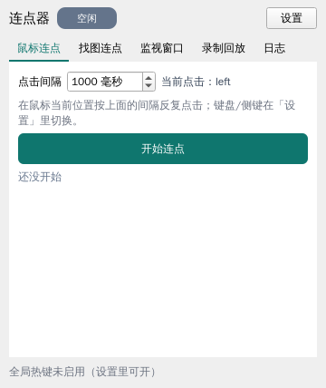

# 连点器 AutoClicker


一个跨平台（Windows / Linux / macOS）的鼠标连点器，C++17 + Qt6 Widgets + OpenCV 实现。
界面、配置、脚本格式都沿用之前的 Python 版本，方便从老版本平滑迁移。



## 下载安装包

到 [Releases](https://github.com/shunbogeng/auto-clicker/releases) 页面下载对应平台的文件：

| 平台 | 文件 | 用法 |
| --- | --- | --- |
| Windows 10/11 x64 | `AutoClicker-windows-x64.zip` | 解压后**先跑一次 `Unblock-and-Run.bat`**（见下方说明），之后双击 `AutoClicker.exe` 即可 |
| Linux x64 | `AutoClicker-linux-x86_64.AppImage` | `chmod +x AutoClicker-linux-x86_64.AppImage` 后直接运行 |
| macOS 12+ | `AutoClicker-macos.dmg` | 拖进「应用程序」；未签名未公证，首次打开需右键 → 打开，并在「系统设置 → 隐私与安全性 → 辅助功能 / 屏幕录制」里授权 |

### Windows 首次打开慢 / 被 SmartScreen 拦？（免费解决办法）

从网上下载的 zip 会带一个「来自网络」的标记，Windows 每次启动都要先查一遍，SmartScreen 还会弹「无法识别的应用」。因为没有代码签名证书，这是必然的。免费解法：解压后双击包里的 **`Unblock-and-Run.bat`**（一键解除锁定并启动），它会对整个文件夹执行一次 `Unblock-File`（去掉那个标记）然后启动程序；之后启动就快很多，也不会再弹 SmartScreen。

手动做也等效：在解压出来的文件夹里打开 PowerShell，执行

```powershell
Get-ChildItem -Recurse -File | Unblock-File
```

还有更彻底的两条（都不花钱，代价是别的）：把程序目录加入 Defender 排除项；或者自签名证书签名（只对本机有效，跨机器仍然不被信任）。

## 功能

| 功能 | 说明 |
| --- | --- |
| 鼠标连点 | 在**鼠标当前位置**按设定的间隔反复点击，支持左键 / 右键 / 中键 / 侧键 X1、X2 / 键盘按键，可勾选双击 |
| 找图连点 | 用一张模板图在屏幕上查找，命中后点它的中心（可加偏移）；支持多目标、只点 N 次、找不到就停 / 继续等 |
| 监视窗口 | 盯着**某个窗口**（按进程名 / 标题匹配），窗口被遮挡也能截到画面；目标图出现后自动把窗口提到最上层再点击 —— 适合云游戏排队这类「进不去前台但必须点」的场景 |
| 录制回放 | 全局录制鼠标 + 键盘动作，原速回放或固定间隔回放，可循环 N 轮 / 一直循环，脚本可命名、可多份保存 |
| 全局热键 | 只有**一个**热键，在「设置」里改：按下就启动/停止**当前页签**的功能。**默认关闭**（不占键位）。支持字母、数字、F1–F24、方向键、Home/End/PageUp/PageDown、小键盘、符号键，也能带 Ctrl/Alt/Shift |
| 单实例 | 只允许一个进程，重复启动会把已有窗口切到前台，不再弹提示 |
| 日志页 | 独立日志页，运行过程全在日志里，可清空 |

## 全局热键

整个程序只有一个热键，**默认 F6、默认关闭**，在「设置 → 全局热键」里打开并改成你顺手的位置。改法就是点一下按钮，然后按你想用的键：

| 页签 | 热键按下时做什么 |
| --- | --- |
| 鼠标连点 | 开始 / 停止连点 |
| 找图连点 | 开始 / 停止找图点击 |
| 监视窗口 | 开始 / 停止监视 |
| 录制回放 | 录制中 → 结束录制；回放中 → 停止回放；否则 → 开始录制 |
| 日志 | 没有可切换的功能（会提示一句） |

支持的键：`a–z`、`0–9`、`f1–f24`、方向键、`home` `end` `pageup` `pagedown` `insert` `delete`、小键盘 `num0–num9` 与四则键、符号键（`-` `=` `,` `.` `/` `\` `;` `'` `[` `]` `` ` ``），以及 `space` `tab` `esc` `enter` 等，可以叠加 `Ctrl` / `Alt` / `Shift`。配置文件里写成 `ctrl+alt+g` 这种形式即可。

> 原先的「全局急停键」已整体移除，没有任何键会替你强制中断；要停就在界面上点对应页的停止按钮。

## 快速上手

1. 打开程序，窗口默认只占屏幕一小块，可拖动缩放。
2. 想连点：在「鼠标连点」页设好间隔 → 把鼠标放到要点的位置 → 点「开始连点」（或在设置里开了全局热键后按它）。
3. 想找图：在「找图连点」页「选图片 / 截屏框选」，**也可以直接把图片拖到窗口里** → 「测一下能不能找到」确认能命中 → 开始。
4. 想盯后台窗口：在「监视窗口」页填进程名（如 `game.exe`）或标题关键词 → 选目标图 → 开始监视。命中后程序会先把窗口提到最上层，再点目标位置。
5. 想录制：到「录制回放」页点「开始录制」，照平常操作一遍，再点一次结束 → 给脚本起名字。之后选脚本、设节奏和循环次数即可回放。

配置文件、模板图、录制脚本的位置：

- Windows：程序所在目录（不可写时退到 `%APPDATA%/AutoClicker`）
- Linux / macOS：程序所在目录（不可写时退到 `~/.local/share/AutoClicker`）

目录结构：`config.json`、`templates/`（模板图）、`scripts/`（录制脚本，JSON）。

## 从源码构建

依赖：CMake ≥ 3.20、C++17 编译器、Qt 6（Core/Gui/Widgets/Network）、OpenCV（core/imgproc/imgcodecs）。

### Linux（X11）

```bash
sudo apt install qt6-base-dev qt6-base-dev-tools libqt6opengl6-dev libopencv-dev \
                 libxtst-dev libx11-dev libxcomposite-dev libxfixes-dev libxrandr-dev \
                 ninja-build pkg-config
cmake -S . -B build -G Ninja -DCMAKE_BUILD_TYPE=Release
cmake --build build -j
./build/AutoClicker
```

X11 扩展用途：`XTest`（模拟输入）、`XComposite`（截被遮挡窗口）、`XRecord`（录制）。

### Windows（MSVC）

```powershell
cmake -S . -B build -G "Visual Studio 17 2022" -A x64 -DOpenCV_DIR=C:\opencv\build
cmake --build build --config Release
```

### macOS

```bash
brew install opencv qt
cmake -S . -B build -DCMAKE_BUILD_TYPE=Release -DCMAKE_PREFIX_PATH=$(brew --prefix qt)
cmake --build build -j
```

## 测试

```bash
# 逻辑自检（键名映射、配置回环、找图、脚本读写、任务启停）
./build/ac_selftest

# 端到端（需要 X11，会真注入点击、真录制、真回放）
./build/ac_e2e
```

端到端测试会启动一个靶子窗口 `ac_target_window`，在它上面验证「截图 → 找图 → 点击落点 → 录制 → 回放」的完整链路。

## 目录结构

```
src/
  core/      配置、日志、键名、找图、任务、录制、热键、业务总控
  platform/  平台抽象层：PlatformWin.cpp / PlatformX11.cpp / PlatformMac.mm
  ui/        主窗口、设置对话框、全屏框选浮层
tests/       靶子窗口、自检、端到端
packaging/   Windows / Linux / macOS 打包脚本
docs/        使用说明、架构说明
```

平台差异（模拟输入、截屏、窗口查找与置顶、全局热键、全局钩子）全部收敛在 `src/platform/Platform.h` 这一层，上层代码不碰任何平台 API，换平台只改一个文件。

## 首次运行时 Windows 会弹「已保护你的电脑」

这是 SmartScreen 对「从网上下载、没有开发者签名」的 exe 的默认拦截，不是报毒。

最快的办法：点弹窗里的「更多信息 → 仍要运行」（或直接「仍要运行」）。

想以后都不弹，把文件的「来自 Internet」标记去掉即可（解压前做一次，解压出来的文件都不带标记了）：

1. 右键下载的 `AutoClicker-windows-x64.zip` → 属性 → 勾选「解除锁定」→ 确定；
2. 再解压。

已经解压过的，在解压目录里开 PowerShell 执行：

```powershell
Get-ChildItem -Recurse | Unblock-File
```

彻底的正解是给 exe 加代码签名证书（OV 约每年 ¥1500–2500，仍要积累下载量后才不再弹；EV 约每年 ¥3000 以上，签名即刻生效，但需要企业资质），个人自用没必要。不建议把系统 SmartScreen 整体关掉。

## 免费签名（自签名，仅限自己的机器）

如果不想每次都点「仍要运行」，可以给 exe 加一张自签名证书，本机就不会再弹「未知发布者」：

```powershell
pwsh -File packaging\windows\sign_selfsigned.ps1 -ExePath .\dist\AutoClicker\AutoClicker.exe
```

脚本会建一张 `CN=AutoClicker Dev` 的代码签名证书（5 年有效），导入当前用户的「受信任的根证书颁发机构」和「受信任的发布者」，然后用 Windows SDK 的 signtool 签名。

注意：这只对**装过这张证书的电脑**有效（就是你自己这台），别人下载后仍然是「未知发布者」。要消除陌生用户的提示，只有正规 CA 的证书：开源项目可以免费申请 SignPath Foundation 的 OV 签名（要求公开仓库 + OSI 许可 + 在 CI 里签名，见 https://signpath.org/）。

## 已知限制

- **Linux Wayland**：Wayland 不允许普通程序全局注入输入 / 截屏 / 抓全局热键。请用 X11 会话（登录界面选 "X11"），或在 XWayland 下运行（部分功能仍会受限）。
- **macOS**：必须在「系统设置 → 隐私与安全性」里授予「辅助功能」和「屏幕录制」权限，否则点击无效、截图是黑屏。默认未签名，首次打开需要在「隐私与安全性」里允许。
- **Windows**：系统限制后台程序抢前台，`activateWindow` 里做了 Alt 键绕行 + TOPMOST 闪现，仍可能被部分全屏独占游戏挡住。
- 监视窗口模式依赖「能截到目标窗口」：Windows 用 `PrintWindow(PW_RENDERFULLCONTENT)`，Linux 用 `XComposite`，macOS 用 `CGWindowListCreateImage`。极少数使用独占全屏 / 反截屏保护的窗口抓不到画面，日志里会提示。

## 许可证

MIT。分发的安装包里 Qt6 以 LGPLv3 动态链接，详见打包目录中的第三方声明。
